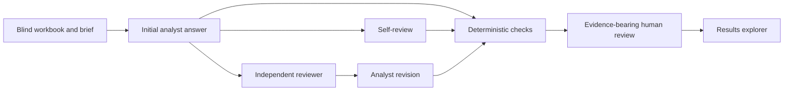

# Finance Review Lab

Can AI identify and repair financial model errors without breaking correct work?

**Development benchmark toolkit:** four original public cases, conservative grading, offline run capture and a results explorer. The example results are simulated software fixtures. Real model trials and human scoring remain pending.

The research question is whether self-review or independent AI review improves financial-model auditing, and when review causes a correct answer to become wrong.



## Start here

Requires Python 3.10+ for the runner and verifier. No Python packages or API key are needed. Node 18+ is optional for viewer software tests; a modern browser opens the viewer.

```sh
python3 -m unittest discover -s tests -v
python3 verify_suite.py
python3 -m frl export dev-002 exports/dev-002.zip
```

Open `viewer/index.html` and select `reports/demo-report.json` to explore **simulated software fixtures**. To use the explicit example button, serve the project locally:

```sh
python3 -m http.server 8765 --bind 127.0.0.1
```

Open http://127.0.0.1:8765/viewer/. No external service is contacted. The viewer starts empty. Example fixtures include scripted adjudication records; they are not human reviews or model performance.

## Public development cases

| Case | Model | Reference-only description |
| --- | --- | --- |
| case-001 | Distributor operating model | Working-capital sign error |
| dev-002 | Logistics debt schedule | Opening balance used instead of stated average-debt interest convention |
| dev-003 | Services valuation bridge | Excess cash deducted rather than added |
| dev-004 | Equipment operating forecast | Correct control with contraction and expansion capex |

Descriptions and answers are public for reproducibility. Only a blind export belongs in an evaluated chat. These cases are excluded from future headline evaluation scores.

## Scoring

A successful audit must detect all material root causes, propose valid live repairs, quantify required impacts and avoid material false corrections. Recall, finding precision, repair validity, numerical impact, propagation and clean-case performance are separate metrics. There is no weighted composite.

The evaluator executes restricted formulas against base inputs and two perturbations. Equivalent supported formulas can pass; unsupported Excel syntax routes to review. Evidence-bearing human detection, explanation and restraint verdicts are required before a completed answer can pass. Finite probes do not prove general equivalence. Refusals, malformed responses and incomplete attempted tasks count as failures; genuine infrastructure failures stay visible and excluded.

The runner freezes input hashes, preserves raw answers and grade history, and links review branches to the same initial response. It cannot authenticate model labels, enforce provider settings, prove faithful transcription or attest human identity.

## Project map

- `cases/`: blind workbooks, briefs and metadata.
- `references/`: public answers, manifests, expected outputs and rubrics. Keep away from evaluated sessions.
- `frl/`: offline export, capture, grading and reports.
- `prompts/` and `templates/`: instructions and editable run/adjudication templates.
- `viewer/`: local results explorer and software tests.
- `reports/demo-report.json`: explicitly simulated demonstration.
- `scripts/`: optional authoring, packaging and fixture utilities.
- `docs/`: specification, operator guide, provenance, limitations and unpublished drafts.

Read [the run guide](docs/run-guide.md), [the benchmark specification](docs/benchmark-spec.md), and [the progress log](docs/progress.md). The planned 20 private evaluation cases do not exist yet.

The [pilot planner](docs/pilot-campaign.md) freezes a balanced queue of 24 development trials from two actual configurations and three repetitions per case. The [human-review workflow](docs/human-review.md) produces metadata-blinded review packets bound to exact responses and reference manifests. Neither workflow supplies model answers or human judgments.

## Reproduction and limits

Verification reads shipped XLSX formulas/caches and recomputes financial outputs independently with Python Decimal. It checks input/style parity, intended formula differences, downstream changes, circular dependencies, panes, print settings and external links.

Workbooks were authored/recalculated with OpenAI Artifact Tool. Optional builders require that separate runtime, which is not bundled. Evaluation and verification work without it. See [case-authoring guidance](docs/case-authoring.md).

**Native Microsoft Excel checks passed on disposable copies:** all eight workbooks matched across 908 formula caches after Calculate Now and save. A zero-interest input change also recalculated correctly. Whole-workbook print previews for dev-002, dev-003 and dev-004 showed one page per sheet. See [native QA coverage](docs/native-excel-qa.md) and its hash-bound report. The original case's printed pages remain unverified. The small, public development suite supports software/workflow validation, not unseen finance capability claims. AI authoring QA is not human expert validation or a blind trial.

Code: MIT. Original synthetic cases and reference data: CC BY 4.0; see `LICENSE-DATA`. Third-party authoring tools have separate terms and are not redistributed. Source publication does not establish model performance. No hosted service, API key or paid model access is required to use the offline toolkit.
